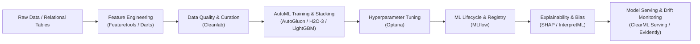

# 🚀 Awesome Custom Predictive Modeling

**🌟 A curated index of enterprise SaaS platforms, AutoML ecosystems, automated feature engineering frameworks, and open-source machine learning libraries for custom predictive modeling.**

[🏢 Explore SaaS Platforms](#-saas-hosted-platforms) • [📈 Sector Overview & Market Dynamics](#-sector-overview--market-dynamics) • [🛠️ Open-Source Ecosystem](#️-open-source-github-projects) • [🏗️ Architecture Blueprint](#️-architecture-blueprint-building-a-custom-predictive-platform) • [⭐ Star History](#-star-history) • [💖 Support](#-support) • [🤝 Contributing](#-how-to-contribute)

---

## 📌 Overview

**Custom Predictive Modeling** empowers businesses and developers to forecast outcomes, detect churn, score leads, predict risk, and forecast time-series metrics from tabular, multi-table, and relational datasets. Whether using enterprise-grade no-code AI platforms or self-hosted, code-first AutoML stacks, this ecosystem automates feature synthesis, model selection, hyperparameter tuning, model explainability (SHAP/LIME), and real-time inference serving. 🎯

---

## 📈 Sector Overview & Market Dynamics

The global predictive analytics and predictive modeling market was valued at **$19.9B–$20.6B in 2025** and is projected to surpass **$65.2B–$82.3B by 2030**, growing at a rapid CAGR of **25.9% to 28.3%**. 🌐

The sector is **moderately to highly fragmented** rather than winner-take-all: large cloud conglomerates (Microsoft, Salesforce, AWS, Google) compete alongside pure-play enterprise AI unicorns (DataRobot, Dataiku, H2O.ai) and niche specialized vendors focusing on verticalized domains, low-code operational intelligence, and self-hosted open-source pipelines. 💡

---

## 🏢 SaaS Hosted Platforms

A comprehensive breakdown of leading custom predictive modeling SaaS platforms, ranked by **company size (market capitalization / enterprise valuation / ARR)** in descending order: 📊

| 🏢 Company / Product | 💼 Size (Valuation / Revenue) | 🏷️ Starting Pricing | 🎁 Free Tier / Free Trial Limits | ⚡ Primary Strengths & Capabilities |
| :--- | :--- | :--- | :--- | :--- |
| **[Salesforce Einstein Prediction Builder](https://help.salesforce.com/)** | **~$188B** Market Cap (CRM) | **$165 / user / month** *(via CRM Analytics Plus; Enterprise / Unlimited Edition required)* | **"Try Einstein" Free Tier** *(Limited to building up to 10 predictions and enabling 1 active prediction at a time on standard/custom objects)* | Point-and-click predictive modeling directly embedded into Salesforce CRM workflows. Min. 400 training records. |
| **[DataRobot](https://www.datarobot.com/)** | **$6.3B** Valuation (Series G) | **~$100,000 / year** *(Custom enterprise subscription; ~$8,333/mo equivalent)* | **30-Day Free Trial** *(Full Workbench access, limited shared worker threads and compute credits, capped vector stores)* | End-to-end enterprise AutoML, MLOps, model registry, monitoring, and generative AI guardrails. |
| **[Dataiku](https://www.dataiku.com/)** | **$3.7B** Valuation ($350M+ ARR) | **~$4,000 / month** *(Enterprise Cloud edition; custom annual terms)* | **Free Forever Edition (Self-Hosted)**: Up to 3 users on local/on-prem install with core ML pipelines. **Cloud Trial**: 14 days, max 2 users, 4 vCPU / 32 GB RAM limit. | Collaborative data science platform connecting business analysts and ML engineers across clouds. |
| **[H2O.ai](https://h2o.ai/)** | **$1.7B** Valuation (Series E) | **$25,000 / year** *(H2O AI Cloud baseline node via AWS Marketplace; ~$2,083/mo equivalent)* | **90-Day Free Trial** *(H2O AI Cloud evaluation sandbox with hands-on Driverless AI access)* | Industry-standard Driverless AI, automated feature engineering, and enterprise AI cloud infrastructure. |
| **[Pecan AI](https://www.pecan.ai/)** | **~$350M** Est. Valuation ($118M Funded) | **$1,500 / month** *(Billed annually; custom data connector add-ons)* | **14-Day Free Trial** *(Access to Predictive GenAI modeling workflows, 1 data connector, and sample business predictive pipelines)* | Predictive AI agent automating data preparation and delivering direct predictions to Snowflake, BigQuery, and CRMs. |
| **[KNIME](https://www.knime.com/)** | **~$150M** Est. Valuation (€30M+ ARR) | **€19 / month (~$21/mo)** *(KNIME Pro tier; Team tier at €99/mo)* | **Free Forever Desktop Edition**: Complete KNIME Analytics Platform (unlimited rows, no time limit, fully featured open desktop application). | Modular visual node-based workflow builder for data prep, ML training, time series forecasting, and K-AI assistance. |
| **[Akkio](https://www.akkio.com/)** | **~$75M** Est. Valuation ($18M Funded) | **$49 / month** *(Basic tier; $99/mo for Professional tier)* | **14-Day Free Trial** *(No credit card required; access to generative analytics and predictive modeling actions)* | Fast, generative AI-powered predictive analytics designed for business intelligence analysts and marketing agencies. |
| **[dotData](https://www.dotdata.com/)** | **~$70M** Est. Valuation ($54M+ Funded) | **$3,000 / month** *(Enterprise private offer baseline on AWS/Azure; billed annually)* | **No Self-Serve Trial** *(Free access provided via dotData Academy educational sandbox & guided proof-of-concept demos)* | Automated feature discovery and relational feature engineering across multi-table transactional databases. |
| **[Obviously AI](https://obviously.ai/)** | **~$25M** Est. Valuation ($9.7M Funded) | **$75 / month** *(Standard tier; $145/mo for Pro tier)* | **7-Day Free Trial** *(Self-serve CSV/data connection trial with up to 3 model builds and prediction exports)* | One-click no-code predictive analytics enabling citizen data scientists to build tabular models in seconds. |
| **[BigML](https://bigml.com/)** | **~$15M** Est. Valuation ($4.4M Funded) | **$30 / month** *(Bronze subscription tier; scales to $300/mo Gold tier)* | **Free Forever Account**: Datasets capped at 16 MB, maximum 2 concurrent tasks, up to 60 total tasks. **Trial**: 3-day full-feature trial on signup. | Transparent machine learning as a service (MLaaS) with web UI and REST API for classification and anomaly detection. |

---

## 🛠️ Open-Source GitHub Projects

The premier open-source predictive modeling libraries, AutoML frameworks, automated feature engineering suites, and production MLOps tools. **Sorted strictly by GitHub Stars_Count (descending)**: 🌟

| 🔢 Rank | 📦 Framework / Project | ⭐ GitHub_Stars | 📜 License | 🧠 Core Predictive Focus & Architecture |
| :---: | :--- | :---: | :---: | :--- |
| 1 | **[scikit-learn](https://github.com/scikit-learn/scikit-learn)** |  | BSD-3-Clause | The gold standard foundational machine learning library for Python. Classification, regression, clustering, preprocessing, and model evaluation pipelines. |
| 2 | **[XGBoost](https://github.com/dmlc/xgboost)** |  | Apache-2.0 | Optimized distributed gradient boosting library engineered to be highly efficient, flexible, and portable across CPU, GPU, and distributed Spark clusters. |
| 3 | **[MLflow](https://github.com/mlflow/mlflow)** |  | Apache-2.0 | Complete open-source platform for the machine learning lifecycle, covering experiment tracking, reproducible projects, model registry, and unified deployment. |
| 4 | **[SHAP](https://github.com/shap/shap)** |  | MIT | Game-theoretic approach (Shapley Additive exPlanations) to explain the output of any machine learning model with global and local interpretability. |
| 5 | **[Prophet](https://github.com/facebook/prophet)** |  | MIT | Time-series forecasting tool developed by Meta designed for business forecasting at scale with robust handling of trends, seasonality, and holiday effects. |
| 6 | **[LightGBM](https://github.com/microsoft/LightGBM)** |  | MIT | Fast, distributed, high-performance gradient boosting framework using tree-based learning algorithms with histogram binning and leaf-wise tree growth. |
| 7 | **[Optuna](https://github.com/optuna/optuna)** |  | MIT | Next-generation hyperparameter optimization framework with define-by-run API, automated trial pruning, and distributed tuning algorithms. |
| 8 | **[LIME](https://github.com/marcotcr/lime)** |  | BSD-2-Clause | Local Interpretable Model-agnostic Explanations for explaining what machine learning classifiers and regressors are doing for individual predictions. |
| 9 | **[Cleanlab](https://github.com/cleanlab/cleanlab)** |  | AGPL-3.0 | Data-centric AI package that systematically detects and corrects label errors in datasets to dramatically boost model predictive accuracy. |
| 10 | **[AutoGluon](https://github.com/autogluon/autogluon)** |  | Apache-2.0 | State-of-the-art AutoML toolkit by AWS for tabular, multimodal, and time series data featuring multi-layer ensembling and automated stacking. |
| 11 | **[TPOT](https://github.com/EpistasisLab/tpot)** |  | LGPL-3.0 | Automated machine learning tool that optimizes complete machine learning pipelines using genetic programming on top of scikit-learn. |
| 12 | **[PyCaret](https://github.com/pycaret/pycaret)** |  | MIT | Low-code machine learning library that automates model training, hyperparameter tuning, ensembling, and deployment in just a few lines of code. |
| 13 | **[Darts](https://github.com/unit8co/darts)** |  | Apache-2.0 | User-friendly Python library for time series forecasting and anomaly detection, featuring models from ARIMA to deep learning (TFT, N-BEATS). |
| 14 | **[CatBoost](https://github.com/catboost/catboost)** |  | Apache-2.0 | High-performance gradient boosting library with state-of-the-art out-of-the-box handling of categorical features and minimal hyperparameter tuning required. |
| 15 | **[Auto-sklearn](https://github.com/automl/auto-sklearn)** |  | BSD-3-Clause | Automated machine learning toolkit replacing scikit-learn estimators with Bayesian optimization, meta-learning, and automated ensemble construction. |
| 16 | **[Evidently](https://github.com/evidentlyai/evidently)** |  | Apache-2.0 | Open-source ML observability framework for evaluating, testing, and monitoring predictive models and detecting data/concept drift in production. |
| 17 | **[Featuretools](https://github.com/alteryx/featuretools)** |  | BSD-3-Clause | Framework for automated feature engineering that transforms transactional and relational datasets into feature matrices using Deep Feature Synthesis. |
| 18 | **[H2O-3](https://github.com/h2oai/h2o-3)** |  | Apache-2.0 | Distributed in-memory machine learning platform supporting GLM, Gradient Boosting, Deep Learning, and AutoML across Python, R, and REST APIs. |
| 19 | **[InterpretML](https://github.com/interpretml/interpret)** |  | MIT | Unified framework providing glass-box explainable models (Explainable Boosting Machine - EBM) and black-box explanation methods. |
| 20 | **[FLAML](https://github.com/microsoft/FLAML)** |  | MIT | Fast and lightweight AutoML library by Microsoft that optimizes cost-effective ML pipelines and multi-agent system tuning. |

### 🔬 Specialized Emerging Libraries & Utilities

- **[ClearML Serving](https://github.com/allegroai/clearml-serving)** — Production model serving infrastructure for deploying ML/AutoML models as scalable REST APIs.
- **[features-goldmine](https://pypi.org/project/features-goldmine/)** — Automated feature engineering package generating candidate features via LightGBM tree paths and competitive validation.
- **[Raikura](https://pypi.org/project/raikura/)** — Modular Python ML library extending scikit-learn with time series, fairness auditing, and YAML-driven pipelines.
- **[FELITS](https://pypi.org/project/felits/)** — End-to-end time series analysis library featuring STL decomposition, lag features, mutual information, and Optuna optimization.
- **[FairLabeler](https://github.com/fairlabeler/anonymous)** — Model-agnostic preprocessing framework detecting and mitigating biased labels in training data to ensure ethical AI.

---

## 🏗️ Architecture Blueprint: Building a Custom Predictive Platform

Organizations looking to establish self-hosted, vendor-neutral predictive modeling platforms can combine these open-source tools: 🛠️

---

## 📈 Star History

---

## 💖 Support

Thank you for exploring and utilizing **Awesome Custom Predictive Modeling**! 🙏

If you find this repository valuable for your research, team, or projects, please consider supporting us:
- ⭐ **Star this repository** to help others discover it!
- 🍴 **Fork it** and contribute new tools or updates.
- 📢 **Share it** with fellow data scientists, machine learning engineers, and analysts.
- ☕ **Buy me a coffee / Sponsor**: Support ongoing maintenance and curation on the [GitHub Sponsors Dashboard](https://github.com/sponsors/ishandutta2007).

---

## 🤝 How to Contribute

1. 🍴 **Fork the repository** to your personal GitHub account.
2. ✍️ **Add or update an entry**: Ensure SaaS entries include verified starting prices, free tier limits, and valuation/revenue metrics. Open-source entries must include license and official repository links.
3. ⚖️ **Keep it objective**: Maintain factual, neutral descriptions without marketing hyperbole.
4. 🚀 **Submit a Pull Request** with a clear explanation of your additions.

---

## ⚖️ Disclaimer

- 📋 This repository is a community-curated directory for educational and technical evaluation purposes; it does not constitute commercial endorsement.
- 🕒 All pricing, tier limits, and market capitalization/valuation figures are accurate as of March 2026 and are subject to vendor changes.
- 🛡️ Machine learning models deployed into production should comply with ethical AI guidelines, regulatory standards (GDPR, CCPA), and appropriate data privacy laws.

---

Maintained with ❤️ for data scientists, machine learning engineers, and analytics professionals worldwide.

